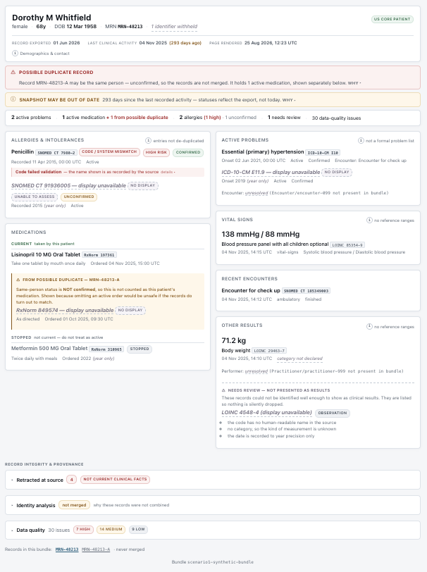
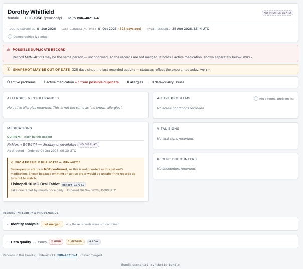
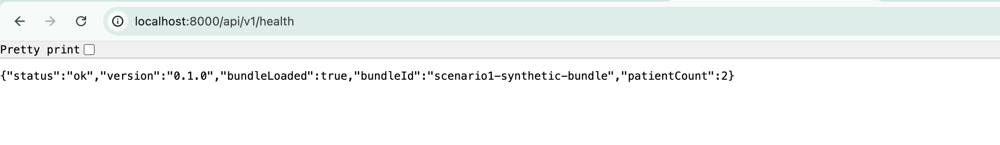
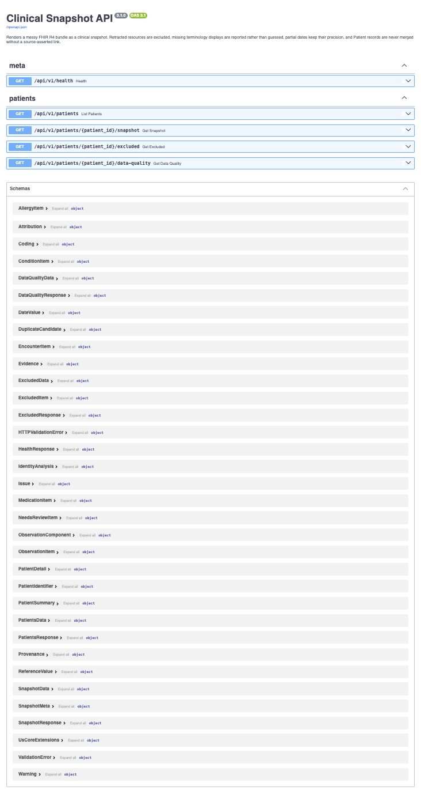

# Clinical Snapshot

A one-page clinical summary built from a deliberately messy FHIR R4 bundle.

The hard part is not rendering a patient summary. It is deciding what the data
actually supports saying — and making the gap between *recorded*, *unknown* and
*retracted* visible instead of smoothing it over.

---

## Assignment overview

The supplied bundle (`data/scenario1_fhir_bundle.json`) is synthetic and
deliberately defective. It contains 17 resources describing what appears to be
one patient, and is seeded with the failure modes real interoperability feeds
exhibit: two Patient records with overlapping identities, resources retracted at
source, codes with no human-readable name, references pointing at resources that
are not present, and dates recorded to inconsistent precision.

A naive implementation renders all of it and is confidently wrong. The task is
to build something that is *correctly* uncertain: it must not merge two patients
on demographic similarity, must not present a retracted lab result as a finding,
must not invent a drug name it does not have, and must not turn `"2019"` into a
specific day.

## Key features

- **Deterministic normalization pipeline** — parse, index, resolve, reconcile,
  classify, normalize. Every stage is pure and separately tested.
- **Clinical-safety classification** — each resource is routed to exactly one of
  `CURRENT` / `HISTORICAL` / `EXCLUDED` / `NEEDS_REVIEW`, with the rule that
  admitted it recorded on the output.
- **Evidence-based patient reconciliation** that refuses to merge without a
  source-asserted link, and reports the evidence on both sides.
- **Precision-preserving dates** — a value object that makes widening a partial
  date structurally impossible.
- **Auditable terminology** — a display is either the source's, or cited from a
  curated map of FHIR-specification CodeSystems, or absent. Never inferred.
- **A typed data-quality log** returned with every response: 30 issues on the
  supplied bundle, severity-ranked.
- **A clinician-oriented UI** where uncertainty is a first-class visual system
  rather than an afterthought.

## Screenshots

### The snapshot



Everything a clinician needs is in the first viewport. Note what the page is
careful about:

- **`ICD-10-CM E11.9 — display unavailable`** — the source supplied no name for
  this code, so none is shown. It is not guessed.
- **`Onset 2019 (year only)`** — the precision the source recorded, not widened
  to a specific day.
- **`Code failed validation — the name shown is as recorded by the source`** —
  "Penicillin" is exactly what the record says, but its code is not a
  well-formed SNOMED CT identifier, so the code is barred from any matching.
- **`FROM POSSIBLE DUPLICATE — MRN-48213-A`** — an active medication belonging to
  a record that may or may not be the same person. Shown, attributed, and
  explicitly *not* counted as this patient's.
- **`Encounter: unresolved (Encounter/encounter-099 not present in bundle)`** —
  distinct from "no encounter recorded".
- **`Retracted at source 4`** — four resources were withdrawn by the source.
  They are listed for transparency and appear in no clinical section.

### Scope isolation — the second record



The same application viewing `MRN-48213-A`. This is the clearest demonstration
that the two Patient records are **not merged**: this record has 0 active
problems, 0 allergies and no vital signs of its own, and Lisinopril — which is
the *other* record's medication — appears here under the same attributed block,
in the opposite direction. Its date of birth also renders as
`1958 (year only)`, which is precisely why a day-level identity match could
never be established.

### API





Generated OpenAPI at `/docs`, covering all five endpoints and every response
schema.

## Architecture

```
                data/scenario1_fhir_bundle.json
                              │
   ┌──────────────────────────▼──────────────────────────┐
   │ 1  FHIR / Pydantic validation      fhir/models.py    │
   │    Lenient R4 subset: every field optional, unknown  │
   │    fields preserved. A bad resource degrades itself, │
   │    never the bundle, and is reported.                │
   ├─────────────────────────────────────────────────────┤
   │ 2  Resource indexing               fhir/index.py     │
   │    Addressable by fullUrl, ResourceType/id and type. │
   │    Duplicates are never overwritten; conflicts are   │
   │    returned as data.                                 │
   ├─────────────────────────────────────────────────────┤
   │ 3  Reference resolution            fhir/resolver.py  │
   │    Four outcomes: resolved / unresolved / type       │
   │    mismatch / malformed. Never fabricates a target.  │
   ├─────────────────────────────────────────────────────┤
   │ 4  Patient reconciliation          domain/identity.py│
   │    Scores evidence both ways and stops. No merge     │
   │    without a source-asserted Patient.link.           │
   ├─────────────────────────────────────────────────────┤
   │ 5  Clinical safety policy          domain/safety.py  │
   │    verificationStatus before clinicalStatus. Routes  │
   │    every resource to exactly one disposition.        │
   ├─────────────────────────────────────────────────────┤
   │ 6  Normalization                   domain/assembler.py│
   │    Terminology, date precision, renderability,       │
   │    cross-record attribution, issue collection.       │
   ├─────────────────────────────────────────────────────┤
   │ 7  ClinicalSnapshot read model     domain/snapshot.py│
   │    Snapshot + NormalizationResult. The frontend      │
   │    never sees FHIR.                                  │
   └──────────────────────────┬──────────────────────────┘
                              │
                    FastAPI   │   schemas/responses.py
                              │
                    Next.js / React UI
```

### Layer responsibilities

| Layer | Module | Responsibility |
|---|---|---|
| Validation | `fhir/models.py`, `fhir/loader.py` | Model the R4 subset consumed. Report structural defects (`bdl-1` violation, non-UUID `urn:uuid:`, duplicate ids) without rejecting the bundle. |
| Indexing | `fhir/index.py` | One addressing authority. Structural only — it never consults clinical status, so a retracted resource indexes like any other. |
| Resolution | `fhir/resolver.py` | Pure, no I/O. Distinguishes four outcomes and preserves the original reference string in every one. |
| Identity | `domain/identity.py` | Compares Patient records, grades confidence, and produces evidence. Never merges on its own authority. |
| Safety | `domain/safety.py` | The disposition rule table, plus structured exclusion reasons. |
| Renderability | `domain/renderability.py` | Whether an Observation can be *identified* well enough to present — separate from whether it is *safe* to present. |
| Terminology | `domain/terminology.py` | Display resolution, with a hard scope rule, plus code-shape validation. |
| Temporal | `domain/partial_date.py` | Precision-preserving dates and interval comparison. |
| Assembly | `domain/assembler.py`, `domain/views.py` | Build the read model; collect issues; attribute cross-record data. |
| API | `api/`, `schemas/` | Thin. `fhir/models.py` models what the source *sent*; `schemas/responses.py` models what we are willing to *say*. |
| UI | `apps/web` | Honest rendering. Performs no clinical filtering of its own. |

## Repository structure

```
clinical-snapshot/
├── README.md                      this file
├── AI_USAGE.md                    how the AI assistant was used and corrected
├── Makefile                       install / api / web / test / lint / typecheck
├── docker-compose.yml             api + web, api gated on a healthcheck
├── .env.example                   environment template (no real values)
├── data/
│   └── scenario1_fhir_bundle.json the supplied bundle, unmodified
├── docs/
│   ├── DECISIONS.md               rule tables, evidence analysis, open items
│   ├── screenshots/               images used by this README
│   └── assignment-brief.pdf       the original brief, for context
└── apps/
    ├── api/                       Python · FastAPI · Pydantic
    │   ├── pyproject.toml         deps, pytest, ruff and mypy config
    │   ├── Dockerfile             non-root runtime image
    │   ├── src/clinical_snapshot/
    │   │   ├── main.py            app factory, CORS, problem+json handlers
    │   │   ├── config.py          pydantic-settings
    │   │   ├── logging_config.py  structured JSON logging, PHI-free
    │   │   ├── api/               service layer + v1 routes
    │   │   ├── fhir/              models, loader, index, resolver
    │   │   ├── domain/            pure, I/O-free normalization logic
    │   │   ├── schemas/           API response models
    │   │   └── terminology/       curated display map (YAML, each entry cited)
    │   └── tests/                 unit · safety · integration + fixtures
    └── web/                       TypeScript · React · Next.js
        ├── package.json           scripts and dependencies
        ├── Dockerfile             non-root runtime image
        ├── app/                   layout, page, loading, error, global CSS
        ├── components/            section components + uncertainty primitives
        ├── lib/                   API client, contract types, derived age
        └── tests/                 vitest + React Testing Library
```

## Technology stack

| Layer | Technology | Version in use |
|---|---|---|
| Backend framework | FastAPI | 0.141.1 |
| Validation | Pydantic | 2.13.4 |
| Settings | pydantic-settings | ≥2.3 |
| ASGI server | Uvicorn | ≥0.30 |
| Terminology map | PyYAML | ≥6.0 |
| Backend tests | pytest | 9.x |
| Backend lint / types | ruff, mypy (`strict`) | ≥0.6, ≥1.11 |
| Frontend framework | Next.js (App Router) | 16.3 |
| UI | React | 19.2 |
| Language | TypeScript (`strict`, `noUncheckedIndexedAccess`) | 5.x |
| Frontend tests | Vitest + React Testing Library + jsdom | 4.x / 16.x |
| Containers | Docker Compose | — |

No CSS framework, no component library, no state-management library, and no
database. The frontend has exactly three runtime dependencies: `next`, `react`,
`react-dom`. **The application makes no LLM calls** — `anthropic` is not a
dependency and is imported nowhere.

## Data processing

**Parsing.** Lenient by design: every field is optional and unknown fields are
preserved. A resource that fails validation is excluded *and reported*
(`RESOURCE_UNPARSEABLE`); it never takes the bundle down.

**Indexing.** A duplicate never overwrites its predecessor. First occurrence in
bundle order answers lookups; shadowed copies remain reachable via
`candidates()`. Conflicts are returned as data (`DUPLICATE_KEY`,
`DUPLICATE_FULL_URL`, `MISSING_ID`), never raised.

**References.** Every `fullUrl` in this bundle is a URN while every reference is
relative. FHIR resolves a relative reference against the base set by `fullUrl`,
and a `urn:` URI establishes no base — so read strictly, **none of the 20
references resolve**. The documented policy is: exact `fullUrl` match, then a
`ResourceType/id` fallback that raises `BDL_REFERENCE_SCHEME_MISMATCH` once at
bundle level, then an unresolved *result object* — never `None`. "No encounter
recorded" and "the encounter is missing" reach the UI as different things.

**Reconciliation.** See below.

**Clinical filtering.** See "Clinical safety decisions".

**Terminology.** In scope: CodeSystems defined by the FHIR specification itself
(`condition-ver-status`, `v3-ActCode`, …) — small, closed, normative, each entry
in `terminology/displays.yaml` citing its source. Out of scope: SNOMED CT,
LOINC, RxNorm, ICD-10-CM. Codes from those with no source display resolve to
`null` and render as *"display unavailable"*. Codes are also structurally
validated against the system they declare.

**Date precision.** `PartialDate` carries the source string byte-for-byte plus
its precision. There is deliberately no method returning a padded date;
`parsed_date` and `parsed_instant` are `None` for year and month precision.
Comparison uses interval overlap, so `1958-03-12` vs `1958` is *consistent*,
never *equal*.

**Uncertainty and data quality.** Every stage emits typed issues into one log
returned with the response — 30 on the supplied bundle, ranked high/medium/low.

## Clinical safety decisions

### Entered-in-error resources
Four resources are retracted, through **two different mechanisms**:

| Resource | Retracted via |
|---|---|
| `observation-004` — creatinine 14.7 mg/dL | `Observation.status` |
| `encounter-002` | `Encounter.status` |
| `condition-002` — asthma | `Condition.verificationStatus` |
| `allergyintolerance-002` — latex | `AllergyIntolerance.verificationStatus` |

`Condition` and `AllergyIntolerance` have no `status` element, so checking
`resource.status` catches only half of them. Both also carry a non-active
`clinicalStatus`, so a clinicalStatus-first rule would hide them *coincidentally*,
report the wrong reason, and still leave the retracted creatinine on screen.
**`verificationStatus` is therefore evaluated before `clinicalStatus`.**

They are routed to a labelled, collapsed drawer rather than deleted: a snapshot
that silently discards a corrected lab result is indistinguishable from one where
the test was never done. The retracted creatinine's *value* is withheld even
there — 14.7 mg/dL is roughly ten times normal, and read alone it implies renal
failure in a patient on an ACE inhibitor.

### Inactive conditions and stopped medications
Real facts, not retractions. `condition` with `inactive`/`remission`/`resolved`
and `medicationrequest-002` (Metformin, `stopped`) are shown as **HISTORICAL**,
under a heading that says *"not current — do not treat as active"*, structurally
separated from the current list. Suppressing them would lose genuine history.

### Uncertain allergies
`allergyintolerance-003` is `active` + `unconfirmed`, criticality
`unable-to-assess`, with no resolvable substance name. It is **displayed**, with
the caveat attached — suppressing an allergy risks an exposure. The classifier's
flags are authoritative and always render.

### Unresolved references
`Encounter/encounter-099` and `Practitioner/practitioner-999` are absent from the
bundle. Both render as *"unresolved (… not present in bundle)"*, visually distinct
from "not recorded", and both raise `REFERENCE_UNRESOLVED`.

### Conflicting patient identifiers
See "Patient reconciliation".

### Missing terminology displays
`E11.9`, `4548-4`, `849574` and `91936005` have no display. The application knows
what several of them are. It does not say so. They render as
*"ICD-10-CM E11.9 — display unavailable"* with a `no display` badge.

This matters more than it looks. `allergyintolerance-001` carries the display
"Penicillin" on `7980-2` — a hyphenated, LOINC-shaped code that is **not a
well-formed SNOMED CT identifier**, while `allergyintolerance-003` carries a
valid SNOMED code with no display. Resolving the latter from model knowledge
could present two entries that are one concept, or equate a *confirmed
high-criticality* allergy with an *unconfirmed unable-to-assess* one. So: no
invented displays, and **no de-duplication of allergies at all**, because
de-duplication means trusting codes and one of these does not validate. The
"Penicillin" label is kept — discarding a high-criticality allergy's name is its
own harm — but marked *"Code failed validation — the name shown is as recorded by
the source"* and barred from any coded matching.

### Partial dates
Six values are year-precision. They render as *"2019 (year only)"*. A safety test
asserts that **every date string in the response appears verbatim in the source
bundle**.

### Why the application does not guess
Every one of these is a place where a plausible guess produces a confident,
wrong clinical statement — a fabricated onset date, an invented drug name, a
retracted result presented as a finding, a merged medication list. In each case
the honest output ("unknown", "unresolved", "not confirmed") is more useful to a
clinician than a smooth one, because it tells them where to look.

## Patient reconciliation

**Determination: `UNRECONCILED`. Confidence: `CONFLICTED`. The records are not
merged.**

`patient-001` and `patient-002` share a surname, a first name, a sex, a
normalised address and a birth year. Merging them is the obvious move and it is
wrong, because the source argues against it:

| Evidence for | Strength |
|---|---|
| family name, given name match | weak |
| sex matches | very weak |
| birth dates consistent (`1958-03-12` vs `1958`) | weak — consistency is not confirmation |
| address normalises identically | moderate |
| MRNs share a root (`MRN-48213` / `MRN-48213-A`) | **suggestive only** |

| Evidence against | Strength |
|---|---|
| **two distinct identifier values in the same assigning system** | strong |
| **no `Patient.link`** — FHIR offers `replaced-by`/`replaces`/`refer`/`seealso`; the source used none | strong |
| same surname at same address — the textbook MPI false positive | strong |
| SSN exists on one record only, so the one high-entropy identifier cannot be cross-checked | blocks confirmation |
| birth-date precision differs; a day-level match was never established | blocks confirmation |

**Confidence grading, in precedence order:** a source-asserted `Patient.link` is
`CONFIRMED` and the only merge-authorising state; **conflicting strong
identifiers outrank every demographic signal**; only then can a matching
high-entropy identifier reach `PROBABLE`; demographic agreement alone never
exceeds `POSSIBLE`. Even `PROBABLE` does not merge — only the source system may
assert identity.

**What happens instead.** The snapshot is scoped to `patient-001` — a *selection
of which record to display*, not a merge. `medicationrequest-003` (active, RxNorm
`849574`, no resolvable name) belongs to `patient-002` and **is shown**, in its
own attributed block: *"From possible duplicate — MRN-48213-A. Same-person status
is NOT confirmed."*

That disclosure is deliberate. Under asymmetric loss it dominates hiding it: if
the records are the same person, omitting an active medication breaks medication
reconciliation; if they are not, the provenance label means no clinician mistakes
it for this patient's drug.

Three or more overlapping records produce **pairwise** candidates, not a merged
cluster — clustering would assert a transitive identity claim the evidence does
not support.

## API

Base URL `http://localhost:8000`. Interactive docs at `/docs`; OpenAPI at
`/openapi.json`. Every response is an envelope of `meta`, `data` and `issues`.
All errors are RFC 7807 `application/problem+json`.

### `GET /api/v1/health`
Liveness, plus whether the configured bundle actually loaded.

**Parameters:** none. **Errors:** none — always 200 while the process serves.

```json
{ "status": "ok", "version": "0.1.0", "bundleLoaded": true,
  "bundleId": "scenario1-synthetic-bundle", "patientCount": 2 }
```

A corrupt or missing bundle returns `"status": "degraded"` with
`"bundleLoaded": false`, **still 200** — a liveness probe that fails on a bad
bundle stops the stack coming up rather than letting it come up and say what is
wrong. A readiness probe should require `bundleLoaded`. `GET /health` is an
unversioned alias kept for the container healthcheck.

### `GET /api/v1/patients`
Every Patient record in the bundle plus any duplicate candidates, with the
evidence on both sides. **Parameters:** none. **Errors:** 503 if the bundle is
missing or unparseable.

### `GET /api/v1/patients/{patient_id}/snapshot`
The clinical snapshot for one patient.

**Parameters:** `patient_id` — a FHIR id, constrained to `^[A-Za-z0-9\-.]{1,64}$`.

**Errors:** `404` unknown patient · `422` malformed id (rejected before any
handler runs; the response names the field, never the value) · `503` bundle
unavailable.

```json
{
  "meta": {
    "patientId": "patient-001",
    "bundleTimestamp": "2026-06-01T09:00:00Z",
    "latestClinicalActivity": "2025-11-04T15:00:00Z",
    "daysSinceLatestActivity": 293,
    "scopeNote": "Scoped to Patient/patient-001. No Patient records were merged."
  },
  "data": {
    "conditionsCurrent": [{
      "id": "condition-003",
      "code": { "system": "http://hl7.org/fhir/sid/icd-10-cm", "code": "E11.9",
                "display": null, "displayStatus": "unresolved",
                "systemName": "ICD-10-CM", "displaySource": "unavailable",
                "usableForCodedLogic": true },
      "onset": { "value": "2019", "precision": "year" },
      "encounter": { "reference": "Encounter/encounter-099", "resolved": false,
                     "reason": "REFERENCE_TARGET_NOT_IN_BUNDLE" },
      "categoryDeclared": false,
      "provenance": { "resourceId": "condition-003",
                      "admittedBy": "RULE_CONDITION_CURRENT" }
    }]
  },
  "issues": [
    { "code": "TERMINOLOGY_DISPLAY_MISSING", "severity": "medium",
      "message": "No display available for ICD-10-CM code 'E11.9'. Rendered without a human-readable label rather than guessing one." }
  ]
}
```

Note what the shape forces: `display: null` beside `displayStatus: "unresolved"`
means a consumer cannot render a name without deciding what to do about its
absence, and `onset` cannot be formatted without acknowledging its precision.

### `GET /api/v1/patients/{patient_id}/excluded`
Resources retracted at source. Served on a **separate endpoint** so they cannot
be rendered beside clinical sections by accident. Each item carries its
`suppressionReason` and the `suppressionField` that carried the retraction.
Same parameters and errors as `/snapshot`.

### `GET /api/v1/patients/{patient_id}/data-quality`
The full typed issue log with a severity summary. Same parameters and errors.

## Frontend

**Page structure.** A single route (`app/page.tsx`), rendered as a React Server
Component that fetches from the API with `cache: "no-store"`. `?patient=<id>`
selects which record to view.

Reading order top to bottom: identity → three labelled freshness dates → safety
banners → at-a-glance counts → clinical grid (allergies, medications | problems,
vitals, encounters, other results) → record integrity drawers.

**Major components.** `PatientHeader` (identity + freshness), `Banners`,
`GlanceStrip` (derived counts), `AllergyList`, `MedicationList`, `ConditionList`,
`ObservationList`, `OtherResults`, `EncounterList`, `RecordIntegrity`
(retracted / identity evidence / data quality).

**Uncertainty primitives** — `components/primitives/`. Every place the UI could
imply more confidence than the data supports goes through one of four:
`PartialDate` (renders `2019 (year only)`, never widens), `CodeLabel` (renders
*"ICD-10-CM E11.9 — display unavailable"*, never falls back to the bare code
styled as a name), `ReferenceLabel` (distinguishes unresolved from absent),
`CodeCaveat` (the validation warning, as visible text rather than a tooltip).

**State handling.** None. There is no client-side state library and no client
component — the page is server-rendered on every request, so the UI cannot drift
from the API.

**Loading / error / empty states.** `app/loading.tsx` mirrors the real layout so
nothing reflows, and announces itself with `role="status"` + `aria-busy`.
`app/error.tsx` deliberately does not render `error.message` — on a clinical page
an unexpected error could carry payload fragments — and shows a digest instead.
An API-unavailable failure is handled inline with specific guidance and shows no
stale clinical data. Every list has an explicit empty state, several of them
clinically careful (*"No active allergies recorded. This is not the same as 'no
known allergies'."*).

**Data-quality warnings.** Two non-dismissible banners (duplicate record,
staleness) with the reasoning folded behind "Why"; a count in the glance strip;
and the full log grouped by severity in a drawer.

**Accessibility.** `:focus-visible` rings, a skip link, one `<h1>` with correct
heading order, six `<section>`s exposed as landmarks via `aria-labelledby`,
clinical rows as `<ul>/<li>` so item counts are announced, `role="status"` rather
than an assertive `role="alert"` for statically-present banners, `aria-current`
on the record switcher, decorative glyphs `aria-hidden`, and all colour pairs at
WCAG AA or better (lowest measured 5.02:1). Status is never conveyed by colour
alone — every badge carries a text label.

## Local development

Prerequisites: **Python 3.11+**, **Node 20+**. Docker is optional.

```bash
# 1. Clone and enter
git clone https://github.com/aqkprogrammer/clinical-snapshot.git
cd clinical-snapshot

# 2. Configure environment (optional — the app runs with no env vars)
cp .env.example .env

# 3–4. Install backend + frontend dependencies
make install

# 5. Start the backend (terminal 1)          -> http://localhost:8000
make api

# 6. Start the frontend (terminal 2)         -> http://localhost:3000
make web

# 7. Open the application
open http://localhost:3000

# 8. Run backend tests
make test

# 9. Run frontend tests
make test-web

# 10. Lint
make lint

# 11. Type checking (mypy --strict + tsc)
make typecheck

# 12. Production frontend build
cd apps/web && npm run build
```

Or run everything in containers:

```bash
docker compose up --build      # http://localhost:3000
docker compose down
```

`make check` runs steps 8–11 in one command.

## Backend commands

Run from the repository root unless noted.

| Task | Command |
|---|---|
| Install (incl. dev extras) | `.venv/bin/pip install -e "apps/api[dev]"` (or `make install`) |
| Development server | `make api` — uvicorn with `--reload` on :8000 |
| Tests | `make test` — `pytest tests -q` |
| Lint | `make lint` — `ruff check src tests` |
| Type checking | `make typecheck` — `mypy` with `strict = true` |
| Formatting | `ruff format src tests` — available, **not** wired into a gate (see Known limitations) |

## Frontend commands

Run from `apps/web`.

| Task | Command |
|---|---|
| Install | `npm install` (or `npm ci` from the lockfile) |
| Development | `npm run dev` — :3000 |
| Tests | `npm test` — `vitest run` |
| Tests (watch) | `npm run test:watch` |
| Type checking | `npm run typecheck` — `tsc --noEmit` |
| Production build | `npm run build` |
| Production server | `npm run start` |

There is **no frontend lint script**: `next lint` was removed in Next 16 and no
ESLint config was added. See Known limitations.

## Testing

**360 backend tests** (272 unit, 32 safety, 56 integration) across 12 modules,
and **110 frontend tests** across 3 files.

The tests that matter most are in `apps/api/tests/safety/`, which asserts
properties that must hold for **any** bundle, against the serialized HTTP payload
rather than domain objects:

- no retracted id reaches a clinical section — and all four **are** reported
- the value `14.7` is unreachable from every endpoint
- every display traces to the source or the curated map; unresolved stays `null`
- every rendered date string appears verbatim in the source
- every unattributed clinical item belongs to the snapshot's subject
- no merge without `Patient.link` — with a fixture proving the reverse path works
- every bundle entry is accounted for across all sections (nothing vanishes)
- `codeSystemMismatch` always implies `usableForCodedLogic: false`

Scenario coverage: FHIR parsing and lenient validation (`test_loader`), resource
indexing and duplicate detection (`test_index`), reference resolution across all
four outcomes (`test_resolver`), patient reconciliation across eight scenarios
including conflicting MRN and multiple plausible candidates (`test_identity`),
entered-in-error handling across the full status cross-product (`test_safety`,
53 parametrised cases), missing terminology and code-shape validation
(`test_terminology`), partial dates including birthday and leap-year boundaries
(`test_partial_date`, `age.test.ts`), observation renderability
(`test_renderability`), the normalization result against the real bundle
(`test_normalization`), and API behaviour including malformed bundles and
path-parameter validation (`test_api`, `test_robustness`).

Four adversarial fixtures: a source-asserted `Patient.link`, a fully-retracted
bundle, month-precision dates, and an empty bundle.

The frontend suite concentrates on the uncertainty primitives and on
*separation*: stopped medications never share a list with active ones, a
duplicate record's medication only ever appears inside an attributed block, and
no observation row renders an abnormal indicator.

## Security

- **Secrets.** `.gitignore` was written *before* `git init`, so `.env` has never
  existed in git history — verified with `git log --all --diff-filter=A`. The key
  it holds funds the coding assistant, not the application: **the app makes no
  outbound network calls and needs no API key to run.**
- **`.env.example`** contains variable names, comments and placeholders only.
- **Sensitive-data minimisation.** The SSN is **withheld entirely, not masked** —
  a clinical snapshot has no use for a national identifier. The MRN is retained
  because the duplicate-record warning must name the other record.
  `withheldIdentifierCount` keeps the omission visible rather than making it look
  like absent data. Identity evidence never quotes a strong identifier's value.
- **Logging.** Structured JSON recording counts and the requested patient id
  only, with a forbidden-key filter as a backstop. Resource bodies are never
  logged at any level.
- **No raw FHIR leaves the backend.** `fhir/models.py` models what the source
  sent; `schemas/responses.py` models what we are willing to say.
- **Input validation.** Path parameters are constrained to the FHIR id charset,
  so malformed input is rejected as 422 before reaching a handler or a log line.
- **CORS** is an explicit localhost allowlist, `GET` only, no credentials.
- **Containers** run unprivileged (`snapshot` uid 10001, `node` uid 1000).

## AI-assisted development

Claude Code (`claude-opus-5`) was used throughout. See **[AI_USAGE.md](AI_USAGE.md)**
for the tool and model, where it accelerated the work, and — more usefully — the
places its output was corrected or rejected, including several caught by the test
suite and the type checker rather than by review.

## Design decisions

- **A pure, I/O-free `domain/` layer.** This is what makes the safety properties
  cheap to test exhaustively and is why `mypy --strict` can cover it.
- **`PartialDate` as a value object.** Looks like ceremony for a date string. It
  is the reason precision inflation is structurally impossible rather than merely
  discouraged.
- **A mutable `IssueLog` threaded through the pipeline.** Normally a smell; here
  it is what makes "nothing is silently dropped" enforceable.
- **Four resolver outcomes**, three of which never occur in the supplied bundle.
  That is the difference between handling *this file* and handling *a feed*.
- **`fhir/models.py` separate from `schemas/responses.py`.** Duplication that
  looks removable; it is the boundary stopping a raw FHIR field from reaching the
  client unclassified.
- **Excluded is not deleted.** Retraction is itself clinically meaningful.
- **Attributed disclosure over hiding.** Detailed under Patient reconciliation.

## Tradeoffs

Kept deliberately simple for a time-boxed exercise:

- **The curated terminology map is small.** Correctness and auditability over
  coverage. A real ValueSet/`$lookup` integration slots in behind
  `TerminologyService` without touching callers.
- **Single bundle, configured by path.** Multi-scenario support is a config
  change, not an abstraction.
- **`/excluded` and `/data-quality` re-run the pipeline** rather than deriving
  from one `NormalizationResult`, and use `build()` rather than `normalize()`.
- **`domain/assembler.py` is ~1,090 lines.** It does one job rather than four and
  its longest function is 57 lines, but the `_build_*` view constructors would
  sit comfortably behind their own `ViewBuilder`.
- **`_shorten` for unknown identifier systems** turns
  `http://centaurihealth.example.org/mrn` into `MRN` for display — a shortening
  of what the source said, not an interpretation; the full URI stays in the
  payload.
- **No auth, no persistence, no pagination.** Out of scope for a read-only
  single-bundle viewer.

## Future improvements

Not implemented; realistic next steps for a production system:

- A **persistent data store** rather than re-reading a file per request.
- A real **terminology service** (`$lookup` / `$validate-code`) behind
  `TerminologyService`, with the curated map as an offline fallback.
- **FHIR server integration** — read from a live server with search and paging
  instead of a static bundle.
- **Authentication and authorization**, with per-patient access control.
- **Audit logging** of who viewed which record, which a clinical system requires.
- **Observability** — tracing and metrics on the normalization pipeline.
- **Stronger identity resolution** — a real MPI, and a workflow that lets a data
  steward record a decision and persist it as a `Patient.link`, which is the only
  thing that should ever authorise a merge.
- **Production deployment** — standalone Next.js output, security headers, image
  digest pinning.
- **Broader FHIR resource support** — Immunization, Procedure, CarePlan,
  DocumentReference, Coverage.

## Known limitations

Honest about what is not done:

- **No frontend linter.** `next lint` was removed in Next 16 and no ESLint config
  was added; `tsc --strict` is the only static gate on the frontend.
- **`ruff format` is not a gate.** `ruff check` passes; `ruff format --check`
  reports 20 files it would reformat. Formatting was never wired into `make lint`.
- **`mypy` covers `domain/` and `fhir/` only** — the pure layers where the safety
  logic lives. `api/`, `schemas/` and `v1/` are unchecked.
- **Horizontal overflow below ~480px.** The layout is correct at 1440, 1024, 820,
  600 and 480px; at 390px long codes and badges clip, because `.code-chip` and
  `.badge` are `white-space: nowrap` with no `overflow-wrap` on their containers.
- **Accessibility beyond what is listed** — no automated axe run, and no testing
  with a real screen reader.
- **The web image is ~1.9 GB** because the runtime stage copies the full
  `node_modules` rather than using Next's `output: "standalone"`.
- **Observation renderability** withholds a result only when it is both
  unnameable and unclassifiable. That threshold is a judgement call.

## Submission notes

To verify this project end to end:

```bash
docker compose up --build          # then open http://localhost:3000
make check                         # 360 backend + 110 frontend tests, lint, types
cd apps/web && npm run build       # production build
```

What to look at first, if you have five minutes:

1. **`apps/api/tests/safety/test_invariants.py`** — the properties that must hold
   for any bundle. This is where the clinical-safety argument actually lives.
2. **`docs/DECISIONS.md`** — the full rule tables, the complete identity evidence
   analysis, and a list of known open items carried deliberately.
3. **The running UI** — the duplicate-record banner, the attributed medication,
   `2019 (year only)`, `ICD-10-CM E11.9 — display unavailable`, and the retracted
   drawer.
4. **`AI_USAGE.md`** — the corrections, which are the honest part.
